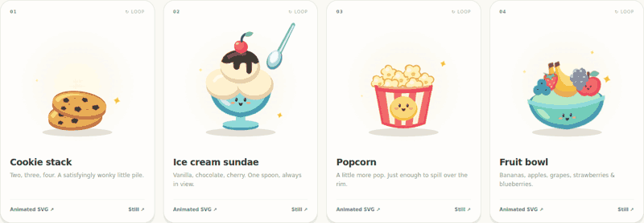
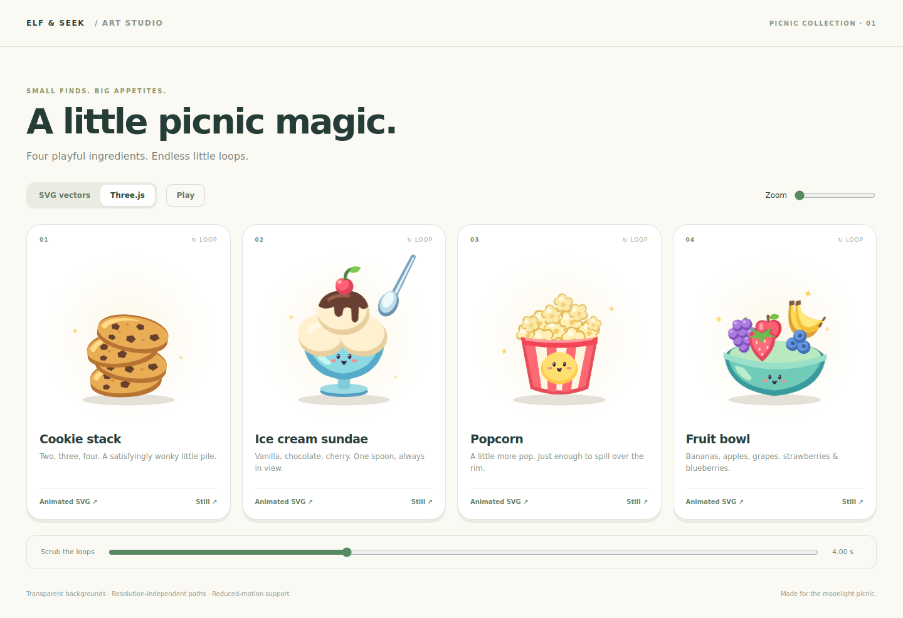

# Picnic ingredient animations

Original chunky, softly shaded cartoon vector artwork for the existing React +
Three.js AR project. No fonts, bitmap textures, sprite sheets, GLBs, or external
asset requests. All four illustrations have transparent backgrounds and a
320 × 320 SVG viewBox. Shapes and timelines share a single source.

| Asset | Loop | Motion |
| --- | --- | --- |
| `cookies` | 5.6 seconds | Two cookies; third drops and settles; fourth drops into a lopsided stack; the extra two fade to reset. |
| `ice-cream` | 4 seconds | Vanilla scoops, chocolate syrup, cherry; a permanently visible spoon dips, lifts a little vanilla, and returns. |
| `popcorn` | 4.8 seconds | Red/white carton with five extra kernels popping into a modest overflow; gently resets. |
| `fruit` | 12 seconds | Bananas, apple, grapes, strawberry, blueberries circulate around a turning, gently rocking bowl with sparkles. |

## Preview and download

Run `npm ci`, then `npm run dev` and open **/ingredients.html**.
The preview switches between SVG and the exact Three.js rig used by the tracker;
it includes pause, timeline scrubbing, zoom, and animated/static SVG downloads.
`npm run build` also includes this page.

The portable files live in `public/ingredients/`:
`cookies.svg`, `ice-cream.svg`, `popcorn.svg`, and `fruit.svg`.
Each also has a `-still.svg` companion. The animated versions use embedded CSS
keyframes and honor `prefers-reduced-motion`. SVG-compatible browsers can display
them directly, in an ``, or inline. Editors that don't implement CSS animation
can use the stills; the shared source contains all editable paths and timing.

## React

```jsx
import { Ingredient } from './src/game/ingredients/Ingredient.jsx';

<Ingredient kind="fruit" className="my-ingredient" />
```

Give the SVG a CSS width/height appropriate to its container. It remains a vector
at every UI size. This decorative component uses `aria-hidden`; put meaningful
labels on the containing control or alongside the illustration.

## Three.js

```js
import {
  makeIngredientModel,
  disposeIngredientModel,
} from './src/game/ingredients/three.js';

const model = makeIngredientModel('ice-cream');
scene.add(model);
// Each render frame; seconds, not milliseconds:
model.userData.animate(elapsedSeconds, prefersReducedMotion);
// When a standalone consumer is finished:
scene.remove(model);
disposeIngredientModel(model);
```

These are **layered 2D vector portraits rendered as Three.js triangle geometry**,
not volumetric food models. They suit the tracker's existing camera-facing portrait
orientation. Curves are tessellated once at construction (48 curve segments), then
only transforms and opacity change. No canvas-texture uploads occur per frame.
Use a camera on the +Z side. A model occupies approximately a 2 × 2 unit artboard
centered at the origin. Materials use flat colors independent of scene lights.

The existing tracker already owns geometry/material cleanup, so it needs no extra
dispose call. A standalone consumer should call the exported disposer once.
Reduced motion sets a useful fixed pose even after animation has already run.

## Existing hunt integration

Marker IDs and scoring remain unchanged (four friends and three treat slots).
The `cookie` kind remains the backwards-compatible scoring key, while the elf
theme's `ingredient` field selects the artwork:

- Marker 1 → cookies
- Marker 2 → ice cream
- Marker 3 → popcorn

Fruit is fully implemented and available in the preview, exports, React component,
and Three.js factory. Set a treat's `ingredient: 'fruit'` to use it in an existing
slot. A fourth collectible requires a separate marker/quest change; this artwork
change does not invent an eighth trail card or alter saved progress.

`Cookie` in the legacy art module wraps `Ingredient` so existing call sites keep
working. It accepts an explicit `kind`, and otherwise maps variants 1–3 as above.

## Editing and verification

Edit `src/game/ingredients/art.js` for paths, poses, and keyframes.
Run `node scripts/export-ingredients.mjs` after changes to regenerate portable SVGs.

Checks: `npm run lint`, `npm test`, `npm run build`, and
`npm run test:e2e -- tests/e2e/ingredients.spec.js`.
Tests cover stack counts, spoon visibility, loop seams, generated-file consistency,
geometry reuse, browser rendering errors, reduced motion, and phone layout.




